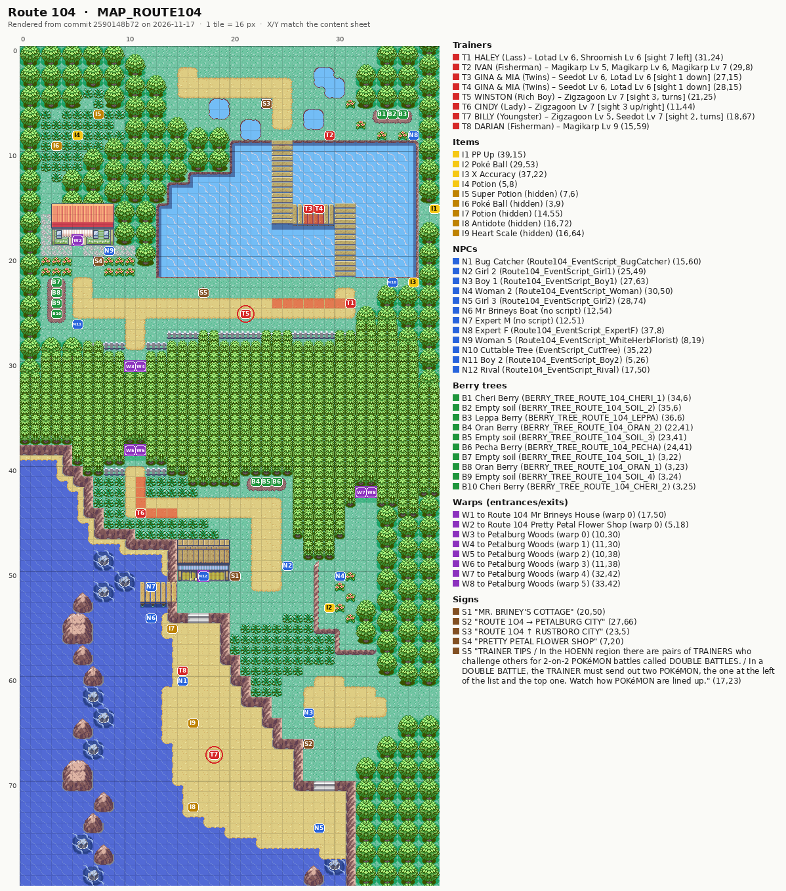

# Map renderer

Draws each area's map straight from the game files (map, layout, tilesets, palettes) at 16 px per tile, adds
numbered markers and a legend, and can upload the PNG to the area's Notion page.



## Setup

Python 3 with Pillow.

- WSL/Ubuntu: `sudo apt install -y python3-pil`
- Anywhere else: `pip install -r tools/map_render/requirements.txt`

## Running it

Run from the repo root:

```sh
python3 tools/map_render/render.py                      # all areas -> build/maps/*.png
python3 tools/map_render/render.py --area "Route 104"   # one area
python3 tools/map_render/render.py --upload             # render and update the Notion pages
```

`build/` is git-ignored. Each image's title shows the git commit and date it was rendered from.

## Notion token

`--upload` needs a Notion integration token in `NOTION_TOKEN`:

1. Create an internal integration at <https://www.notion.so/profile/integrations> with Read, Update and Insert
   content. Then connect it to the parent page of the area pages (••• → Connections).
2. Locally, put `NOTION_TOKEN=ntn_...` in `.env` at the repo root. `.env` is git-ignored, and the token is never
   printed. See `.env.example`.
3. For the GitHub Action, add the same token as a repository secret named `NOTION_TOKEN`
   (Settings → Secrets and variables → Actions → New repository secret).

On each area page, the upload keeps a **Map** heading, the image and one caption line directly above the
**Live game data** heading. The first run adds them; later runs replace the image and caption in place, so pages
never collect duplicates. Nothing else on the page is touched. A page without a "Live game data" heading is
skipped with an error.

The Action (`.github/workflows/map_render.yml`) runs `--upload` on pushes to `main` that change `data/maps/`,
`data/layouts/`, `data/tilesets/`, `src/data/trainers.party` or this tool. It can also be started by hand from the
Actions tab.

## Adding an area

Add an entry to `areas.json`:

```json
{"name": "Route 116", "map": "MAP_ROUTE116", "notion_page": "<32-character Notion page ID>"}
```

The page ID is the last 32 characters of the page's Notion URL. The page needs a "Live game data" heading and must
be shared with the integration. Only the area's main outdoor map is drawn, not building interiors.

## What the markers mean

| Marker | Colour | What it is | Legend shows |
|---|---|---|---|
| T1, T2… | Red | Trainers (object events with a trainer type) | Name (class) – first-battle team, sight range and direction |
| I1, I2… | Yellow | Visible item balls | Item name |
| I… | Dark amber | Hidden items | Item name + "(hidden)" |
| N1, N2… | Blue | Other NPCs and field objects (cut trees, boats…) | Sprite (script label) |
| B1, B2… | Green | Berry trees | Starting berry or "Empty soil" (tree constant) |
| W1, W2… | Purple, with a frame around the tile | Warps (doors, entrances, exits) | Destination map and warp number |
| S1, S2… | Brown | Signs | The sign's text (pages separated by " / ") |

- **Sight lines:** a red strip of tiles shows how far a trainer sees, in each direction it faces. A trainer that
  turns or wanders (rotating, looking around, walking a route) gets a red ring instead. A trainer with sight 0
  gets neither.
- **Coordinates:** the grid has a light line every tile and a darker, labelled line every 10 tiles. Every legend
  line ends with the (X,Y) position, which matches the X/Y columns in the content sheet.
